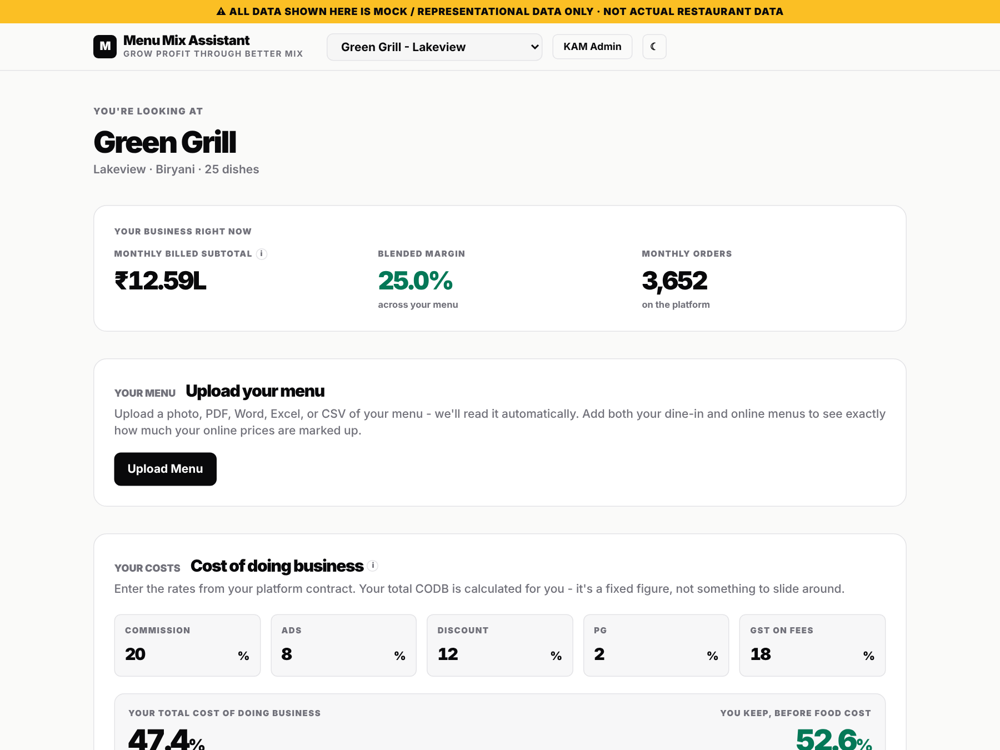
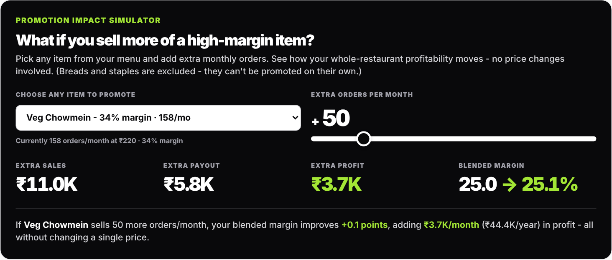
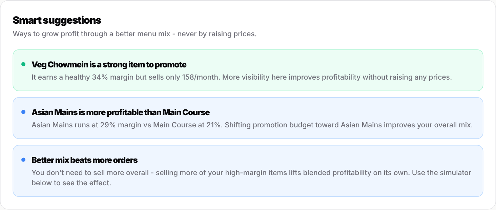

# Menu Mix Assistant

A profit dashboard for restaurants selling on delivery apps. It shows which dishes actually make money once platform costs come out, and what to promote to grow profit without raising a single price.

**[Open the live demo](https://AnshGupta6378.github.io/Menu-Mix-Assistant/)**

> Every restaurant, figure and menu in this demo is synthetic. No real partner data is included.



## Why I built it

Restaurant owners on delivery apps usually track orders and sales. What they rarely see is which dishes earn money after commission, ads, discounts and payment fees are taken out. I built this while working as a key account manager in food delivery, to put that on one screen and turn it into a short list of things to promote.

## What it does

- **P&L snapshot.** Monthly billed sales, blended margin across the menu, and monthly orders for the selected restaurant.
- **Menu upload.** Drop in a photo, PDF, Word file, Excel or CSV of a menu and it reads the dishes and prices. Upload both the dine-in and the delivery menu to see how much each item is marked up online.
- **Cost of doing business.** Enter commission, ads, discount, payment gateway and GST on fees, and it works out the total platform cost and what the restaurant keeps before food cost.
- **Margin target.** Set a healthy margin and compare it against the cuisine's benchmark.
- **Profit opportunities.** Ranks categories by how much profit is available from promoting their high-margin dishes. Breads and staples are left out because they can't realistically be pushed on their own.
- **Promotion simulator.** Pick a dish, add extra monthly orders, and see the extra sales, payout, profit and the change in blended margin.



- **Where profit comes from.** Each category's share of sales against its share of profit, so you can tell profit drivers from volume drivers.
- **Smart suggestions.** Plain-language recommendations based on the numbers above.



- **Account manager view.** A prototype screen for uploading the sales and menu-mix exports that would feed every partner's dashboard, with a check that the expected columns are present.

## How it's built

React and Tailwind, with PapaParse, SheetJS and Mammoth for reading uploaded files and PDF.js for PDFs. I designed the logic and built it with Claude. Vite builds it into the `docs` folder, which GitHub Pages serves.

## Run it locally

```bash
npm install
npm run dev
```

`npm run build` regenerates the site in `docs/`.
